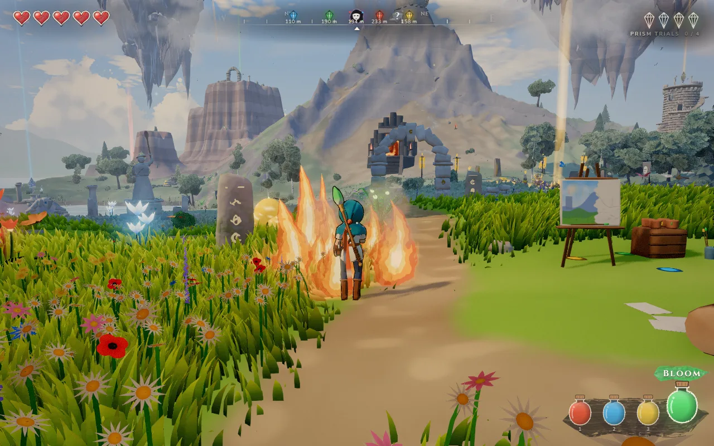
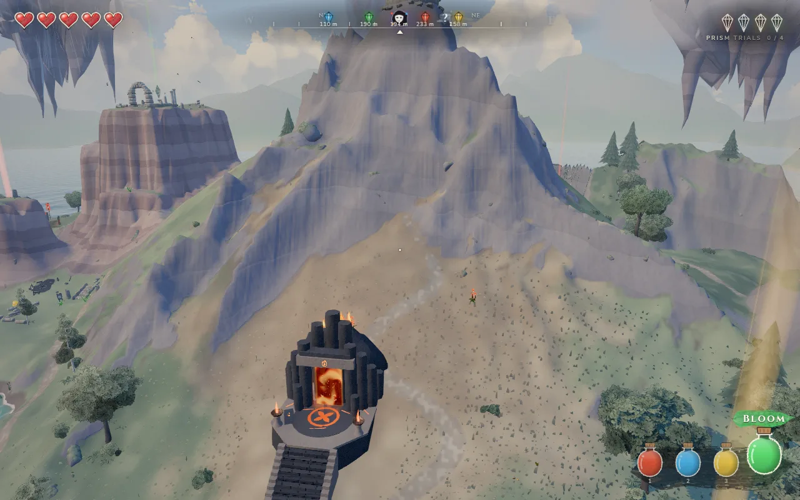
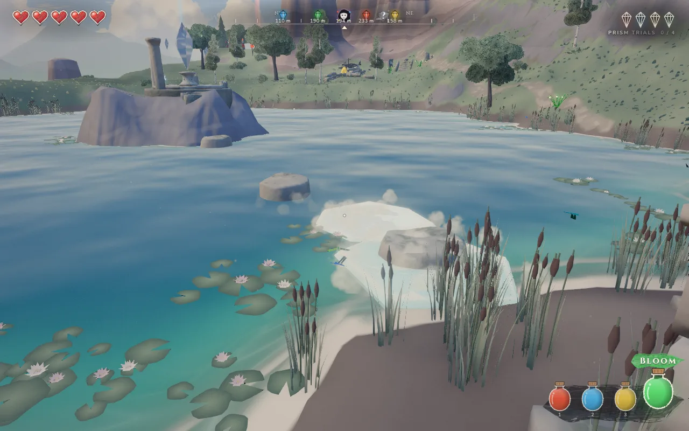

# Wildbrush

<a href="https://orbworlds.com/orb/wildbrush?utm_source=github&utm_medium=readme&utm_campaign=wildbrush"></a>

The island has gone grey. You have four paints, fire, frost, bounce and bloom, and each does something different to whatever it lands on. Paint your way across the island, fight the Smudges, go down into the caverns, through the temples and up to the sky island, and in the end face Greymaw. If other people are playing, you see them in their own outfits, and their paint shows up in your world too.

**[Play it on Orb](https://orbworlds.com/orb/wildbrush?utm_source=github&utm_medium=readme&utm_campaign=wildbrush)**. It runs in the browser on a computer, phone or tablet, and you
don't need an account.

<p>
  
  
</p>

## Controls

WASD to move, mouse to look, Space to jump, click to fight, Tab to slow time and pick a paint. The game teaches the rest as you go.

## Run it yourself

```bash
git clone https://github.com/orbworlds/wildbrush
cd wildbrush
npm install
npm run dev     # work on it, with the page reloading as you save
npm start       # play it the way Orb serves it, through the Orb kit
```

`npm start` packages the world into `.orb/` and opens it at http://127.0.0.1:4242 with the
[Orb kit](https://www.npmjs.com/package/@orbworlds/kit) (`npm install` brings it), which gives it what it gets on Orb: other
players (open a second tab), saves and shared state. You need Node 20 or newer.

What it uses from Orb's world SDK (`window.orb`, typed in `@orbworlds/kit/orb.d.ts`):

- `orb.room` for multiplayer (who is here, what they are doing, messages between players)
- `orb.visitors` to show everyone who is here as a character
- `orb.shop` for the wardrobe, where looks are bought with Orb credits (the money from paid credits goes to the world’s maker)
- plain `localStorage` for progress, which Orb saves per player and brings along to their other devices

Outside Orb and the kit, `window.orb` isn't there and the world carries on without it.

## Make your own version

You can remix it on Orb without touching code: [open it there](https://orbworlds.com/orb/wildbrush?remix&utm_source=github&utm_medium=readme&utm_campaign=wildbrush), choose
**Make my own copy** and describe what you'd change. Orb's AI makes the changes in your copy.

Or fork this repository, make your changes and push them. `npm run share` then prints a link that
brings your fork into Orb as a world of your own, credited as a remix of this one, and it stays in
sync with your fork from then on.

## Contributing

Pull requests are welcome. GitHub checks each one by running the world in a headless browser, which has to go without errors,
and once a change is merged it's live on Orb within about 15 minutes. [CONTRIBUTING.md](CONTRIBUTING.md)
has the details.

## License

MIT, see [LICENSE](LICENSE). The Orb name and logo aren't covered by the license.
